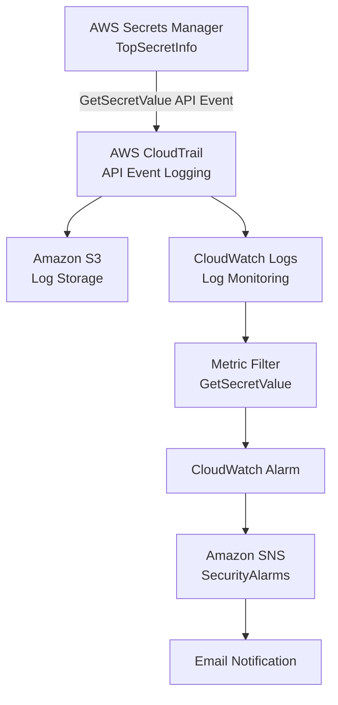

# 🔐 AWS Security Monitoring System

### Automated Secret Access Detection and Email Alerting Using AWS CloudTrail, CloudWatch, and SNS

## 📌 Project Overview

This project demonstrates the implementation of a cloud-based security monitoring system designed to detect and alert on access to sensitive information stored in AWS Secrets Manager.

Using **AWS CloudTrail, Amazon CloudWatch, Amazon SNS, and Amazon S3**, I built an automated monitoring pipeline that captures API activity, identifies secret retrieval events, and generates email notifications when monitored activity occurs.

The project simulates a common cloud security use case: monitoring access to sensitive credentials and providing security teams with visibility into potentially unauthorized activity.

In addition to configuring the monitoring infrastructure, I tested the detection pipeline, investigated an initial alerting failure, and adjusted the monitoring configuration to ensure successful notification delivery.

### 🎯 Project Objectives

- Monitor access to sensitive information stored in AWS Secrets Manager.
- Capture and investigate API activity using AWS CloudTrail.
- Centralize security logs in Amazon CloudWatch Logs.
- Create metric filters to identify secret retrieval events.
- Configure CloudWatch alarms to detect monitored activity.
- Automate email notifications through Amazon SNS.
- Troubleshoot alerting failures and validate the monitoring pipeline.

---

## 🛠️ Technologies Used

| Technology | Purpose |
|---|---|
| AWS Secrets Manager | Securely stores the secret being monitored |
| AWS CloudTrail | Records API activity and secret access events |
| Amazon S3 | Stores CloudTrail log files |
| Amazon CloudWatch Logs | Centralizes logs for monitoring and analysis |
| CloudWatch Metric Filters | Detects specific API events within log data |
| CloudWatch Alarms | Evaluates security metrics and triggers alerts |
| Amazon SNS | Delivers automated email notifications |
| AWS IAM | Manages service permissions and access |
| AWS CloudShell / CLI | Generates test events and supports troubleshooting |

---

## 🏗️ System Architecture

The monitoring system uses multiple AWS services to create an automated detection and notification pipeline.



### How the System Works

1. A user or application retrieves a secret from AWS Secrets Manager.
2. CloudTrail records the `GetSecretValue` API event.
3. CloudTrail delivers event logs to Amazon S3 and CloudWatch Logs.
4. A CloudWatch metric filter identifies matching secret access events.
5. A CloudWatch alarm evaluates the generated metric against a predefined threshold.
6. When the alarm transitions into the `ALARM` state, Amazon SNS sends an email notification to subscribed recipients.

This architecture demonstrates how native AWS services can be integrated to provide automated cloud security monitoring without requiring a third-party SIEM platform.

---

## ⚙️ Project Implementation

### Step 1: Creating a Sensitive Resource in AWS Secrets Manager

I began by creating a test secret in AWS Secrets Manager to serve as the monitored resource.

Secrets Manager provides centralized storage and controlled access to sensitive information, including API keys, passwords, and application credentials.

**Configuration:**

| Setting | Value |
|---|---|
| Secret Name | `TopSecretInfo` |
| Secret Type | Other type of secret |
| Encryption | Default AWS encryption key |
| Rotation | Disabled for testing |
| Purpose | Simulated sensitive information |

The secret contained nonproduction test information and was used to generate controlled access events throughout the project.

**Security Relevance:**

Monitoring access to secrets is important because unauthorized retrieval of credentials may indicate compromised identities, excessive permissions, or suspicious activity within a cloud environment.


---

### Step 2: Configuring AWS CloudTrail

Next, I configured AWS CloudTrail to record API activity within the AWS environment.

CloudTrail provides an audit trail of account activity, including the identity performing an action, the API operation, and the time of the event.

I created a dedicated trail named `secrets-manager-trail` and configured it to deliver logs to an Amazon S3 bucket.

**CloudTrail Configuration:**

| Setting | Configuration |
|---|---|
| Trail Name | `secrets-manager-trail` |
| Multi-Region Trail | Enabled |
| Storage Destination | Amazon S3 |
| Event Type | Management Events |
| API Activity | Read and Write |
| Log File Validation | Enabled |
| AWS KMS Events | Excluded |
| Amazon RDS Data API Events | Excluded |

I enabled management event logging to capture Secrets Manager API operations, including `GetSecretValue`.

Both read and write API activity were included to provide visibility into relevant management operations.

Log file validation was also enabled to support verification of log integrity.

---

### Step 3: Generating and Investigating Secret Access Events

After configuring CloudTrail, I generated test events by accessing the secret through two different methods.

#### Method 1: AWS Management Console

I navigated to the `TopSecretInfo` secret in AWS Secrets Manager and selected **Retrieve secret value**.

This action generated a `GetSecretValue` API request.

#### Method 2: AWS CLI

I used AWS CloudShell to retrieve the same secret programmatically.

```bash
aws secretsmanager get-secret-value \
  --secret-id "TopSecretInfo" \
  --region <aws-region>
```

This allowed me to verify that CloudTrail could capture secret access originating from different interfaces.

#### Investigating CloudTrail Events

I navigated to CloudTrail Event History and filtered events using the following event source:

```text
secretsmanager.amazonaws.com
```

I then identified `GetSecretValue` events associated with the secret retrieval operations.

The recorded events provided information useful for security investigations, including:

- Event timestamp
- API operation
- AWS identity
- Source IP address
- AWS Region
- Target resource
- Request identifiers

**Result: PASS**

CloudTrail successfully recorded the secret access activity, establishing an audit trail for the monitored resource.

---

### Step 4: Integrating CloudTrail with CloudWatch Logs

Once I confirmed that CloudTrail was capturing API events, I configured CloudWatch Logs integration to support automated event detection.

CloudTrail Event History provides visibility into recent API activity, but CloudWatch Logs allows those events to be searched, filtered, and used to generate security metrics.

**CloudWatch Configuration:**

| Setting | Value |
|---|---|
| Log Group | `nextwork-secretsmanager-loggroup` |
| Source | `secrets-manager-trail` |
| IAM Role | `CloudTrailRoleForCloudWatchLogs_secrets-manager-trail` |
| CloudWatch Logs Integration | Enabled |

I created a dedicated IAM role to allow CloudTrail to deliver logs to CloudWatch Logs.

This configuration supports the principle of least privilege by granting the logging service the permissions needed for log delivery.

#### Verifying Log Ingestion

After enabling the integration, I navigated to the CloudWatch log group and inspected its log streams.

I confirmed that CloudTrail events were being delivered and were available for analysis.

**Result: PASS**

CloudTrail successfully forwarded security events to CloudWatch Logs.

---

### Step 5: Creating a CloudWatch Metric Filter

To automatically detect secret retrieval activity, I created a CloudWatch metric filter.

Metric filters examine incoming log events and publish metric values when specified patterns are detected.

For this project, I configured the filter to identify occurrences of the `GetSecretValue` API operation.

**Metric Filter Configuration:**

| Setting | Value |
|---|---|
| Filter Name | `GetSecretValue` |
| Filter Pattern | `"GetSecretValue"` |
| Metric Namespace | `SecurityMetrics` |
| Metric Name | `Secret is accessed` |
| Metric Value | `1` |
| Default Value | `0` |

The filter publishes a metric value of `1` for each matching event, allowing CloudWatch to track secret retrieval activity over time.

The default value of `0` represents periods without matching events when applicable.

#### Detection Logic

```text
IF CloudTrail event contains "GetSecretValue"
    THEN publish metric value = 1
ELSE
    no matching access event detected
```

This converts raw API activity into a measurable security signal.

**Detection Limitation:** The initial filter detects the `GetSecretValue` operation across the monitored logs rather than restricting matches to one specific secret. It is useful for demonstrating secret access monitoring but would require additional filtering for more targeted production detection.

---

### Step 6: Configuring a CloudWatch Alarm

Next, I created a CloudWatch alarm to monitor the custom security metric.

The alarm was configured to detect when at least one matching secret access event occurred during the evaluation period.

**Initial Alarm Configuration:**

| Setting | Value |
|---|---|
| Alarm Name | `Secret is accessed` |
| Metric Namespace | `SecurityMetrics` |
| Metric | `Secret is accessed` |
| Statistic | Average |
| Evaluation Period | 5 minutes |
| Threshold Type | Static |
| Threshold | Greater than or equal to 1 |
| Notification Action | Amazon SNS |

The alarm was designed to transition into the `ALARM` state when the metric met or exceeded the configured threshold.

During testing, I discovered that the initial alarm configuration did not produce the expected notification.

This led to additional investigation and changes to the alarm's metric evaluation settings.

---

### Step 7: Configuring Amazon SNS Notifications

To automate alert delivery, I integrated the CloudWatch alarm with Amazon Simple Notification Service (SNS).

SNS provides a messaging service that can distribute notifications to subscribed endpoints, including email addresses.

I created an SNS topic named:

```text
SecurityAlarms
```

I then added an email subscription to receive notifications when the CloudWatch alarm entered the `ALARM` state.

**SNS Configuration:**

| Setting | Value |
|---|---|
| Topic Name | `SecurityAlarms` |
| Subscription Protocol | Email |
| Notification Source | CloudWatch Alarm |
| Notification Condition | Alarm state transition |
| Subscription Status | Confirmed |

After creating the subscription, I verified the email address using the AWS subscription confirmation message.

This step was necessary because SNS does not deliver topic notifications to an email endpoint until its subscription is confirmed.


---

## 🧪 Testing and Validation

After configuring the monitoring pipeline, I performed several tests to verify that each component operated as expected.

### Test 1: CloudTrail Event Logging

**Objective:** Confirm that AWS CloudTrail records secret retrieval activity.

**Procedure:**

1. Retrieved the `TopSecretInfo` secret using the AWS Management Console.
2. Retrieved the same secret using AWS CLI.
3. Opened CloudTrail Event History.
4. Filtered events by `secretsmanager.amazonaws.com`.
5. Located the generated `GetSecretValue` events.

**Result: PASS**

CloudTrail successfully recorded the secret retrieval operations.

---

### Test 2: CloudWatch Log Ingestion

**Objective:** Verify that CloudTrail events were delivered to CloudWatch Logs.

**Procedure:**

1. Opened the CloudWatch Logs console.
2. Selected `nextwork-secretsmanager-loggroup`.
3. Inspected the available log streams.
4. Confirmed that CloudTrail event records were present.

**Result: PASS**

CloudWatch Logs successfully received CloudTrail event data.

---

### Test 3: Metric Filter Validation

**Objective:** Confirm that the metric filter correctly identifies secret access events.

I tested the filter against sample CloudTrail JSON records containing different Secrets Manager operations.

The sample events included:

- `GetSecretValue`
- `DescribeSecret`
- `GetResourcePolicy`
- `ListSecretVersionIds`
- `CreateSecret`

**Expected Behavior:**

The filter should identify events containing `GetSecretValue` while ignoring records that do not match the configured pattern.

**Result: PASS**

The metric filter successfully identified matching secret retrieval events in the test data.

---

### Test 4: Alarm Notification Testing

**Objective:** Verify that CloudWatch could initiate an alarm notification.

I used AWS CloudShell to manually transition the alarm into the `ALARM` state.

```bash
aws cloudwatch set-alarm-state \
  --alarm-name "Secret is accessed" \
  --state-value ALARM \
  --state-reason "Manually triggered for testing"
```

This test helped isolate the notification process from the metric filter and event ingestion pipeline.

It provided a way to determine whether CloudWatch alarm actions and SNS notifications were functioning independently of the detection logic.

---

### Test 5: SNS Email Delivery

**Objective:** Confirm that Amazon SNS could successfully deliver email notifications.

I tested the SNS topic by publishing a message directly from the SNS console.

**Procedure:**

1. Opened the SNS console.
2. Selected the `SecurityAlarms` topic.
3. Published a test message.
4. Checked the subscribed email inbox.
5. Verified the subscription status.

**Result: PASS**

The test confirmed that SNS could deliver messages to the confirmed email subscription.

---

### Test 6: End-to-End Detection

**Objective:** Validate the complete monitoring and notification workflow.

After troubleshooting the alarm configuration, I retrieved the secret again to generate a new CloudTrail event.

I then monitored the CloudWatch alarm and checked the subscribed email inbox.

**Result: PASS**

The corrected monitoring pipeline successfully detected secret retrieval activity, transitioned the alarm into the `ALARM` state, and delivered an email notification.

---

## 🔎 Troubleshooting and Root Cause Analysis

One of the most valuable aspects of this project was investigating why the initial monitoring configuration failed to generate an expected email notification.

Although the individual AWS services had been configured, the complete detection pipeline did not initially behave as intended.

Rather than rebuilding the environment, I investigated each component to isolate the problem.

### Investigation Process

| Component | Investigation |
|---|---|
| AWS CloudTrail | Verified that `GetSecretValue` events were recorded |
| CloudTrail Integration | Checked CloudWatch Logs delivery configuration |
| CloudWatch Logs | Confirmed that event records were available |
| Metric Filter | Tested detection against sample CloudTrail events |
| CloudWatch Alarm | Examined metric statistics and threshold configuration |
| Amazon SNS | Verified topic configuration and subscription confirmation |
| Email Delivery | Tested direct SNS message delivery |

### Issue Identified: Alarm Statistic Configuration

The initial CloudWatch alarm used the `Average` statistic.

For this use case, the goal was to identify whether one or more matching secret access events occurred within a defined evaluation period.

The `Sum` statistic was better suited to this requirement because it evaluates the total of the metric values published during the period.

I updated the alarm configuration as follows:

| Setting | Initial | Updated |
|---|---|---|
| Statistic | Average | Sum |
| Period | 5 minutes | 1 minute |
| Threshold | ≥ 1 | ≥ 1 |
| Threshold Type | Static | Static |
| SNS Topic | SecurityAlarms | SecurityAlarms |

### Resolution

After updating the alarm configuration, I generated another `GetSecretValue` event.

The monitoring system subsequently transitioned into the `ALARM` state and delivered an email notification through Amazon SNS.

### Key Takeaway

This troubleshooting process demonstrated that successful log ingestion does not automatically guarantee successful alerting.

Each stage of a monitoring pipeline must be validated independently, including event generation, log delivery, filtering, metric evaluation, alarm actions, and notification delivery.

---

## 📊 Project Results

| Test Scenario | Observed Outcome | Status |
|---|---|---|
| Secret retrieval through AWS Console | CloudTrail event recorded | PASS |
| Secret retrieval through AWS CLI | CloudTrail event recorded | PASS |
| CloudTrail to CloudWatch integration | Logs successfully ingested | PASS |
| Metric filter validation | Matching events identified | PASS |
| Initial end-to-end alert test | Expected notification not received | FAIL |
| SNS delivery validation | Test message successfully delivered | PASS |
| Alarm configuration correction | Metric evaluation updated | PASS |
| Final end-to-end monitoring test | Alarm triggered and email delivered | PASS |

### Final Outcome

The completed system demonstrated an automated workflow capable of:

- Recording secret retrieval activity.
- Centralizing AWS security logs.
- Identifying relevant API operations.
- Converting log events into measurable security metrics.
- Triggering CloudWatch alarms based on defined conditions.
- Delivering automated security notifications through Amazon SNS.

The final test confirmed that the monitoring components worked together to detect secret access and notify the configured recipient.

---

## 🧠 Skills Demonstrated

### Cloud Security Monitoring

Configured AWS-native security services to monitor access to sensitive cloud resources.

### Log Analysis and Event Investigation

Used CloudTrail Event History and CloudWatch Logs to investigate API activity and verify event ingestion.

### Detection Engineering

Developed a metric-based detection mechanism using CloudWatch log filters and alarm thresholds.

### Security Alerting and Automation

Integrated CloudWatch with Amazon SNS to automate notifications based on security-relevant activity.

### Troubleshooting and Root Cause Analysis

Investigated an alerting failure by validating individual components and correcting the alarm's metric evaluation configuration.

### AWS Identity and Access Management

Configured service permissions to support CloudTrail log delivery to CloudWatch Logs.

### Security Validation

Performed controlled testing to verify event collection, detection logic, alarm behavior, and notification delivery.

---

## 📚 What I Learned

### 1. Security Monitoring Requires End-to-End Visibility

Collecting logs is only the first step in building an effective security monitoring system.

A functional detection pipeline also requires event filtering, metric evaluation, alert configuration, and reliable notification delivery.

### 2. CloudTrail Provides Valuable Audit Evidence

CloudTrail records API activity that can help investigators determine which identities accessed cloud resources, when the activity occurred, and which operations were performed.

### 3. Metric Selection Affects Detection Reliability

Choosing the correct CloudWatch statistic is essential.

For event-counting use cases, `Sum` is generally more appropriate than `Average` because the goal is to evaluate the total number of matching events during a monitoring period.

### 4. Alert Delivery Must Be Tested Independently

Testing SNS directly helped distinguish notification delivery issues from problems with CloudWatch metrics or alarm evaluation.

### 5. Troubleshooting Is a Core Security Operations Skill

By investigating the pipeline one component at a time, I gained practical experience diagnosing monitoring failures and validating corrective changes.

---

## 🚀 Potential Improvements

Although the monitoring system achieved its intended objective, several improvements could make it more suitable for production security operations.

### 1. Resource-Specific Detection

Replace the basic text filter with a structured JSON filter that matches both the `GetSecretValue` API operation and the intended secret resource.

This would reduce unrelated alerts when other secrets are accessed.

### 2. Identity-Based Alerting

Extend the detection logic to evaluate the identity performing the secret retrieval.

This could help identify access by unexpected IAM users, roles, or service principals.

### 3. Enhanced Event Correlation

Integrate additional CloudTrail event attributes, such as source IP address, user identity, and error codes, to support more contextual investigations.

### 4. Centralized Security Dashboard

Build a CloudWatch dashboard to visualize secret access activity, alert history, and security monitoring trends.

### 5. Automated Incident Response

Integrate AWS Lambda or a security orchestration platform to enrich alerts, create incident tickets, or initiate approved response workflows.

### 6. SIEM Integration

Forward relevant security telemetry to a SIEM platform such as Microsoft Sentinel or Splunk for centralized investigation and correlation with additional security data sources.

---

## 🔐 Security Considerations

This project was implemented as a controlled AWS security monitoring exercise.

The secret used for testing contained nonproduction information.

The monitoring system detects API activity associated with secret retrieval, but a `GetSecretValue` event does not automatically indicate malicious behavior.

In a production environment, alerts should be evaluated alongside identity information, expected application behavior, access policies, and additional security telemetry.

Additionally, CloudWatch alarms generally notify on state transitions rather than generating a new notification for every matching event while an alarm remains in the `ALARM` state.

---

## 🏁 Conclusion

This project provided hands-on experience building and troubleshooting an automated cloud security monitoring system using AWS-native services.

By integrating **AWS Secrets Manager, CloudTrail, CloudWatch, and SNS**, I developed a monitoring pipeline capable of detecting secret retrieval activity and generating automated email notifications.

The project strengthened my understanding of cloud audit logging, event-based detection, metric evaluation, security alerting, and troubleshooting.

Most importantly, it reinforced the importance of validating every component of a security monitoring workflow to ensure that security events are not only recorded but also detected and communicated effectively.

---

## 📖 References

- [AWS CloudTrail Documentation](https://docs.aws.amazon.com/awscloudtrail/latest/userguide/cloudtrail-user-guide.html)
- [Amazon CloudWatch Documentation](https://docs.aws.amazon.com/AmazonCloudWatch/latest/monitoring/WhatIsCloudWatch.html)
- [AWS Secrets Manager Documentation](https://docs.aws.amazon.com/secretsmanager/latest/userguide/intro.html)
- [Amazon SNS Documentation](https://docs.aws.amazon.com/sns/latest/dg/welcome.html)
- [CloudWatch Logs Metric Filters](https://docs.aws.amazon.com/AmazonCloudWatch/latest/logs/MonitoringLogData.html)
