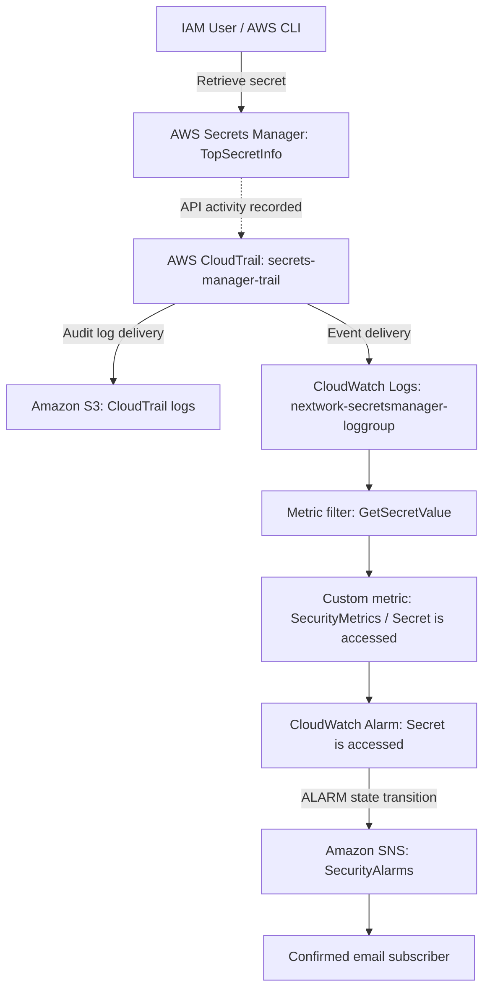

# 🏗️ AWS Security Monitoring System — Architecture

## Overview

This project uses AWS-native services to monitor retrieval of a test secret, preserve an audit trail, evaluate a security metric, and send an email alert. The monitored test secret is `TopSecretInfo`.

## Architecture Diagram

## Components

| Component | Configuration / Responsibility |
|---|---|
| AWS Secrets Manager | Holds the nonproduction test secret `TopSecretInfo` |
| AWS CloudTrail | Trail `secrets-manager-trail` records management API events, including `GetSecretValue` |
| Amazon S3 | Retains delivered CloudTrail audit logs |
| CloudWatch Logs | Log group `nextwork-secretsmanager-loggroup` receives CloudTrail events |
| CloudWatch metric filter | Matches `"GetSecretValue"` in incoming log records |
| Custom CloudWatch metric | Namespace `SecurityMetrics`; metric `Secret is accessed`; matching value `1` |
| CloudWatch alarm | Uses `Sum` over a 1-minute period and threshold `>= 1` |
| Amazon SNS | Topic `SecurityAlarms` distributes alarm notifications to confirmed email subscribers |
| IAM | Grants CloudTrail permission to deliver events to CloudWatch Logs |

## Event Flow

1. A user or application retrieves the secret using the console or AWS CLI.
2. CloudTrail records the `GetSecretValue` management API event. This event is classified as a read operation.
3. CloudTrail delivers logs to S3 for audit retention and to CloudWatch Logs for monitoring. These are distinct delivery paths.
4. The metric filter examines incoming CloudWatch log events for the text `GetSecretValue`.
5. Each matching event publishes a value of `1` to the custom security metric.
6. The alarm evaluates the sum of metric values against the configured threshold.
7. On a transition into the `ALARM` state, CloudWatch invokes the SNS action.
8. SNS delivers an email notification to confirmed subscribers.

## Alarm Settings

| Setting | Initial | Final |
|---|---|---|
| Statistic | Average | Sum |
| Period | 5 minutes | 1 minute |
| Threshold | >= 1 | >= 1 |
| SNS topic | `SecurityAlarms` | `SecurityAlarms` |

The final configuration better aligns with the goal of counting matching events. A one-minute period does not guarantee delivery of an alert within one minute because logging and alarm evaluation are asynchronous.

## Security and Operational Considerations

- `GetSecretValue` indicates retrieval activity, not necessarily unauthorized access.
- The original text filter is not limited to the `TopSecretInfo` resource; resource-specific JSON filtering would improve precision.
- CloudWatch alarm actions generally occur on state transitions, not once for every event while the alarm remains in `ALARM`.
- CloudTrail log delivery to S3 does not by itself establish that CloudWatch Logs delivery is working; verify each path separately.
- Use nonproduction secrets, least-privilege IAM permissions, confirmed SNS subscriptions, and sanitized screenshots.
- Avoid publishing secret values, credentials, account identifiers, or private email addresses.

## Validation

The project verified secret access logging in CloudTrail, log ingestion in CloudWatch Logs, matching of sample events by the metric filter, SNS email delivery, and a successful final end-to-end alert after updating the alarm settings.

## Potential Enhancements

- Filter by `eventSource`, `eventName`, and the exact secret identifier.
- Enrich alerts with principal identity, source IP, and region.
- Add CloudWatch dashboards and SIEM integration.
- Use infrastructure as code for repeatable deployment.

## References

- [AWS CloudTrail](https://docs.aws.amazon.com/awscloudtrail/latest/userguide/cloudtrail-user-guide.html)
- [CloudWatch metric filters](https://docs.aws.amazon.com/AmazonCloudWatch/latest/logs/MonitoringLogData.html)
- [Amazon SNS](https://docs.aws.amazon.com/sns/latest/dg/welcome.html)
