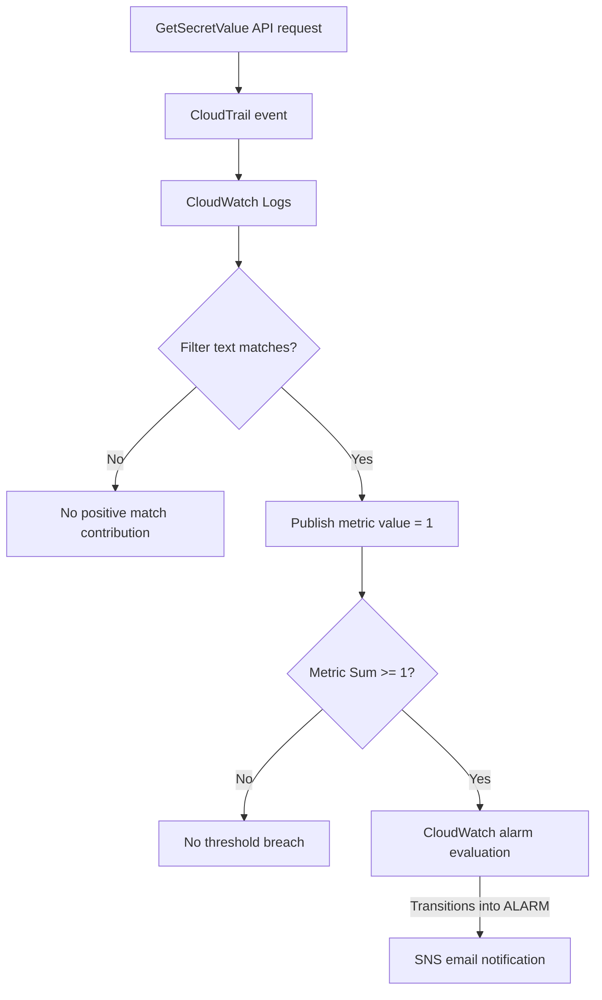

# 🔎 Detection Logic & Alerting Rules

## AWS Security Monitoring System

## Detection Objective

Detect AWS Secrets Manager `GetSecretValue` activity in CloudTrail logs, convert matching log events into a custom CloudWatch metric, and notify a confirmed SNS email subscriber when the alarm threshold is breached.

| Property | Configuration |
|---|---|
| Detection name | Secret Retrieval Detected |
| Data source | AWS CloudTrail management events |
| Log group | `nextwork-secretsmanager-loggroup` |
| Filter name | `GetSecretValue` |
| Original filter pattern | `"GetSecretValue"` |
| Metric namespace | `SecurityMetrics` |
| Metric name | `Secret is accessed` |
| Value per match | `1` |
| Default value | `0` |
| Alarm name | `Secret is accessed` |
| Alarm statistic | Sum |
| Alarm period | 1 minute |
| Alarm threshold | >= 1 |
| SNS topic | `SecurityAlarms` |
| Test resource | `TopSecretInfo` |

## Detection Flow



## Rule 1: Log Event Match

**Implemented filter pattern:**

```text
"GetSecretValue"
```

**Pseudocode:**

```text
For each incoming CloudTrail log event:
    if the log text contains "GetSecretValue":
        publish metric value 1 to SecurityMetrics / Secret is accessed
    otherwise:
        do not publish a positive match value
```

**Expected test cases:**

| API operation | Expected match |
|---|---|
| `GetSecretValue` | Yes |
| `DescribeSecret` | No |
| `CreateSecret` | No |
| `GetResourcePolicy` | No |
| `ListSecretVersionIds` | No |

The original text filter can match occurrences of the string outside the intended `eventName` field; it is a lab demonstration, not a production-grade resource-specific rule.

## Rule 2: Metric Evaluation

Each matching event contributes `1`. For example, two matching `GetSecretValue` records within a monitoring period contribute a sum of `2`. Unrelated API events do not add a positive matching-event count.

**Final alarm logic:**

```text
If Sum(SecurityMetrics / Secret is accessed) >= 1:
    alarm condition is breached
If the alarm transitions into ALARM:
    invoke the configured SecurityAlarms SNS action
```

The actual alarm state also depends on evaluation-period and missing-data settings. The original configuration used `Average` over five minutes; the final successful test used `Sum` over one minute.

## Rule 3: Notification

The SNS topic `SecurityAlarms` delivers notifications to confirmed email subscribers when CloudWatch invokes its configured alarm action.

**Important:** A standard CloudWatch alarm email provides alarm information, not a full copy of the underlying CloudTrail event. The notification is normally tied to an alarm state transition rather than every subsequent event.

## Sanitized Example Event

This is an illustrative example, not a captured production log:

```json
{
  "eventSource": "secretsmanager.amazonaws.com",
  "eventName": "GetSecretValue",
  "eventCategory": "Management",
  "readOnly": true,
  "awsRegion": "us-east-1",
  "userIdentity": {
    "type": "IAMUser",
    "userName": "ExampleUser"
  },
  "sourceIPAddress": "192.0.2.10",
  "requestParameters": {
    "secretId": "TopSecretInfo"
  }
}
```

Fields useful for investigation include `eventName`, `eventTime`, `userIdentity`, `sourceIPAddress`, `awsRegion`, `requestParameters.secretId`, and `errorCode` when present.

## Validation Results

| Test | Expected outcome | Observed result |
|---|---|---|
| Sample `GetSecretValue` event | Match | PASS |
| Sample `DescribeSecret` event | No match | PASS |
| Sample `CreateSecret` event | No match | PASS |
| Initial end-to-end test | Email notification | FAIL |
| Updated alarm configuration and final test | Alarm and email notification | PASS |

## Coverage and Limitations

- The detection identifies API activity, not proof of malicious or unauthorized access.
- Authorized applications and administrators can produce expected `GetSecretValue` events.
- The text pattern does not limit matches to `TopSecretInfo` or check the event source explicitly.
- Delays in CloudTrail and CloudWatch can affect notification timing.
- Alarm state transitions can limit how frequently emails are sent.
- The configured trail and log group must cover the relevant accounts and AWS Regions.
- Default alarm emails do not include full identity and network context from CloudTrail.

## Proposed Detection Improvements (Not Implemented)

### Structured Secrets Manager Event Filter

```text
{ ($.eventSource = "secretsmanager.amazonaws.com") && ($.eventName = "GetSecretValue") }
```

### Resource-Specific Filter

```text
{ ($.eventSource = "secretsmanager.amazonaws.com") && ($.eventName = "GetSecretValue") && ($.requestParameters.secretId = "TopSecretInfo") }
```

The resource-specific example assumes the event contains that exact identifier. Real CloudTrail events should be inspected to confirm whether the identifier is represented as a name or ARN.

Additional improvements include separating successful and failed requests, checking for unexpected principals, enriching alerts with CloudTrail fields, and forwarding events to a SIEM for correlation.

## References

- [AWS CloudTrail](https://docs.aws.amazon.com/awscloudtrail/latest/userguide/cloudtrail-user-guide.html)
- [CloudWatch metric filters](https://docs.aws.amazon.com/AmazonCloudWatch/latest/logs/MonitoringLogData.html)
- [CloudWatch alarms](https://docs.aws.amazon.com/AmazonCloudWatch/latest/monitoring/AlarmThatSendsEmail.html)
